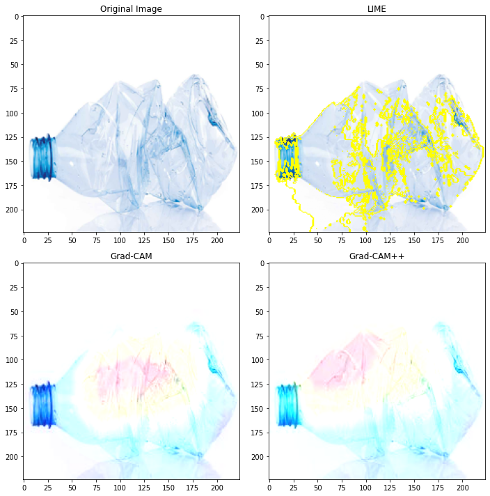
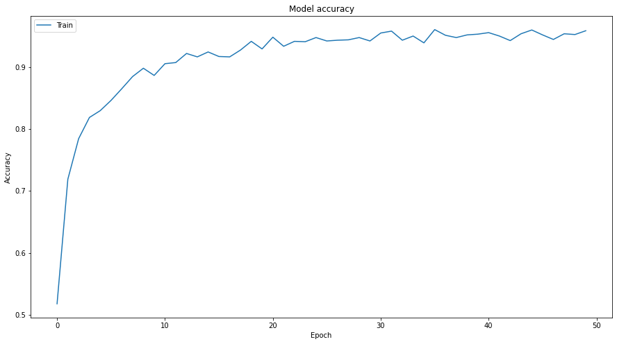
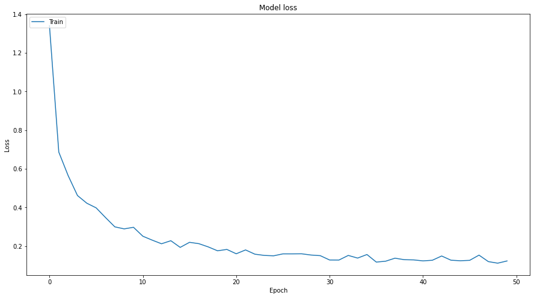
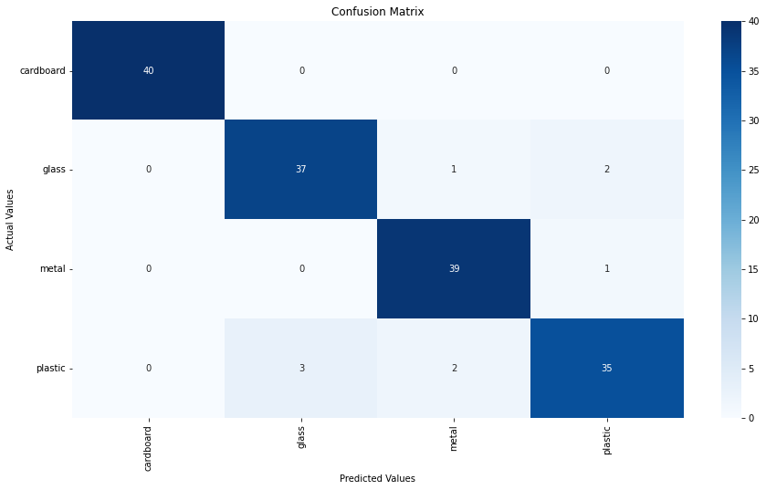
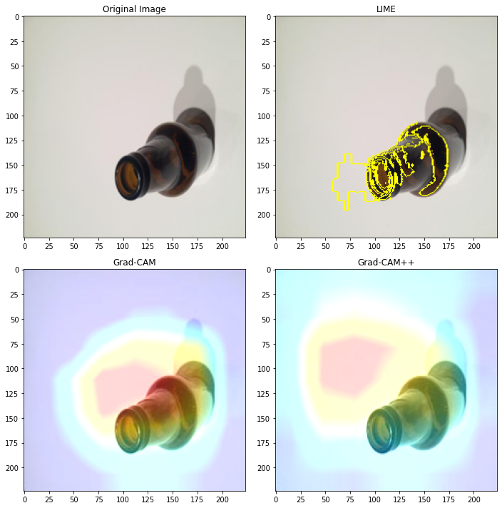
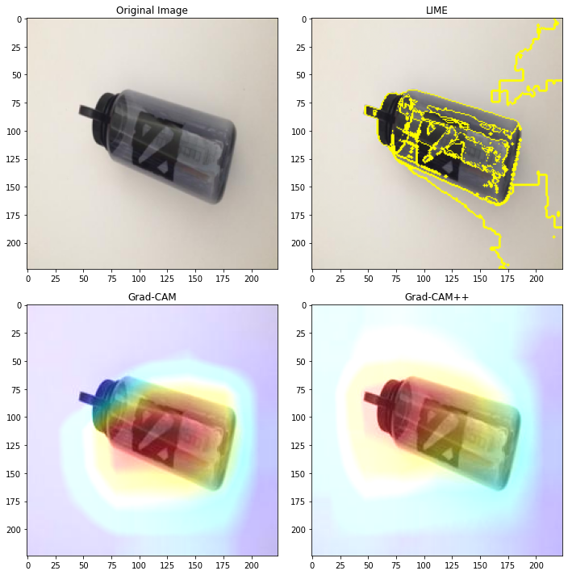
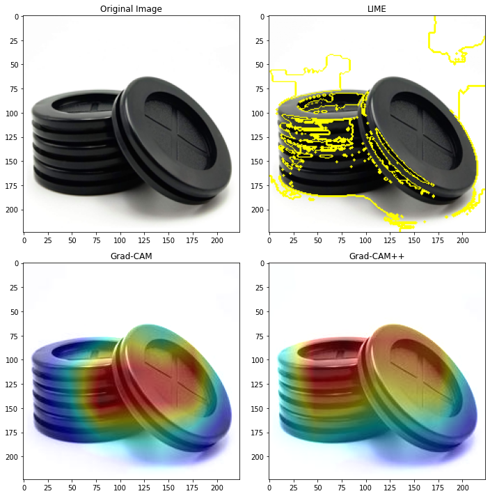

# Waste-Classification

A machine learning model that looks at a photo of a piece of waste and classifies **what material it is made of** — cardboard, glass, metal, or plastic — then tells you roughly how long that material takes to decompose.

It also uses **Explainable AI (XAI)** to show *which part of the image* the model looked at when it made its decision.

## How it works

1. **Input** — a photo of a waste item, resized to 224 × 224.
2. **Classify** — a ResNet50 model pre-trained on ImageNet (transfer learning) with a new classification head predicts one of four materials.
3. **Explain** — three XAI methods highlight the regions that drove the prediction.
4. **Output** — the predicted material plus its approximate decomposition time.

| Material  | Approx. decomposition time |
|-----------|----------------------------|
| Cardboard | A few months               |
| Metal     | ~200 years                 |
| Plastic   | ~450 years                 |
| Glass     | ~1 million years           |

## Results

Trained on 1,636 images from Kaggle's garbage classification dataset and tested on 160 held-out images (40 per class).

**Test accuracy: 94.4%** (151 / 160 correct)

| Training accuracy | Training loss |
|---|---|
|  |  |

Cardboard was classified perfectly. Most mistakes happened between glass and plastic, which makes sense — both are often transparent bottles.

## Explainable AI examples

Each result shows four panels:

- **Original Image** — the input photo
- **LIME** — outlines (yellow) the image regions that most influenced the prediction
- **Grad-CAM** and **Grad-CAM++** — heatmaps where red means "the model focused here"

| Glass bottle → predicted **glass** | Plastic container → predicted **plastic** |
|---|---|
|  |  |

### A limitation

The model only knows four materials. When given a photo of **rubber** (not one of the classes), it still has to pick one — and answered **metal**. The heatmaps show it focused on the dark, shiny edges of the rubber rings, which look similar to metal.

## Tech stack

- Python, TensorFlow / Keras
- ResNet50 (ImageNet weights, transfer learning)
- LIME, Grad-CAM, Grad-CAM++ for explainability
- Google Colab

## Run it

Open the notebook in Colab with the badge above. It expects the dataset in Google Drive under `trash_image/train/` and `trash_image/test/`, with one folder per class.
